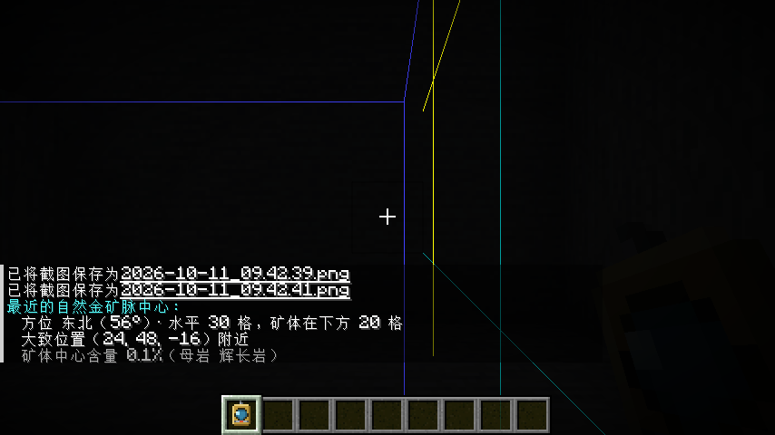
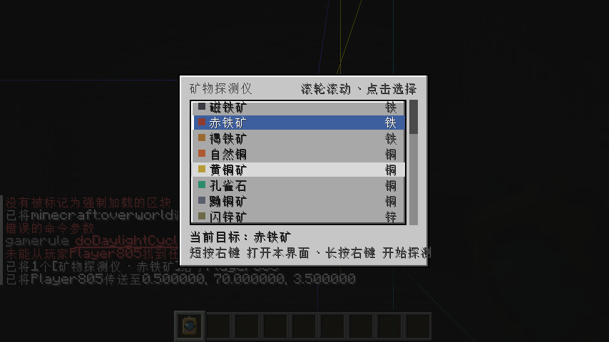

# 地质工业冶金 Geometallurgy

> 地下不生成矿石方块。每个区块按「世界种子 + 区块坐标」确定性地埋着一组虚拟矿脉，
> 你开采的不是矿，而是这块地本身。

一个 Minecraft Fabric 模组：把矿物从"挖方块"变成"读取地质分布 → 采浆 → 选矿 → 冶金 → 化学计量"的完整工业链。



---

## 环境

| 项 | 版本 |
|---|---|
| Minecraft | 26.4-snapshot-3 |
| Fabric Loader | 0.19.5 |
| Fabric API | 0.162.2+26.4 |
| Java | 25 |

开发工具链：Loom 1.18.3 / Gradle 9.7.1 / JDK 25。

---

## 安装

1. 装 Fabric Loader 0.19.5 与 Fabric API 0.162.2+26.4
2. 把 `geometallurgy-x.y.z.jar` 丢进 `mods/`

本模组**内置 Team Reborn Energy 5.0.0**（MIT）作为能量 API。如果整合包里已有自带该 API 的模组（如 Tech Reborn 系），可能因 mod id 重复冲突，届时请反馈。

---

## 核心循环

```
[矿脉抽取机] ──固体矿石──┐
[流体抽取机] ──混合矿浆──┤
                         ├─→ [粉碎机] → 矿粉 ─→ [磁选机] → 精矿 / 尾矿
                         │                     └→ [离心机] → 重相 / 轻相
                         └─→ 精矿 ─┬─→ [还原炉] → 海绵金属（碳热）
                                   ├─→ [电解炉] → 金属（熔盐 / 溶液电解）
                                   └─→ [置换炉] → 金属（湿法）
```

- **找矿**：矿物探勘器扫描区块，读出该区块的矿物种类、伴生相与稀有度
- **采浆**：火力发电机供电，矿脉抽取机与流体抽取机产出矿石与混合矿浆
- **选矿**：粉碎 → 磁选 / 离心，把矿浆分成精矿与尾矿、重相与轻相
- **冶金**：精矿按成分走三条路——还原炉（碳热）、电解炉（熔盐 / 溶液）、置换炉（湿法）
- **化学**：还原炉与反应釜、搅拌器配合，可自产盐酸、硫酸、烧碱、氨，并打通稀土分离链
- **储运**：陶瓷 / 玻璃 / 铅 / 金属四档桶与储罐，按 mol 计量
- **配电**：双界面蓄电池（输入 / 输出可切换）、无线感应器

具体数值、配方与阈值以游戏内**《工程手册》**（`field_manual`）和内置科技线图为准——手册是唯一权威，本 README 不重复数值。



---

## 从源码构建

```bash
./gradlew build
```

产物在 `build/libs/`：

| 文件 | 说明 |
|---|---|
| `geometallurgy-<version>.jar` | 正式产物，装进 `mods/` |
| `geometallurgy-<version>-sources.jar` | 源码，供开发参考 |
| `geometallurgy-<version>-dev.jar` | **开发环境专用，不要给玩家** |

需要 JDK 25。构建脚本用 toolchain 自动选择，不需要在本机配置 `org.gradle.java.home`。

---

## 已知限制

- 只支持 26.4-snapshot-3 这一条版本线，26.x API 仍在变动，跨小版本不保证兼容
- 化学链（氯碱、硫酸、稀土分离）目前依赖反应釜 + 搅拌器两段操作，尚无单方块全自动方案
- 全屏科技线图支持平移，缩放尚未实现

---

## 许可

代码以 **MIT** 发布，见 [LICENSE](LICENSE)。可自由使用、修改、再分发、商用，保留版权声明即可。

## 致谢

- [Team Reborn Energy](https://github.com/TechReborn/Energy) — 能量 API，MIT
- Fabric 与 Minecraft 模组生态的公共工具链

---

## 文档

`docs/` 下是本模组的设计资料，随代码一起公开：

| 文件 | 内容 |
|---|---|
| `科技线-v1.md` | 完整科技线：节点、边、实现顺序 |
| `标准锭与转换台-设计稿.md` | 锭的成分阈值与分支规则 |
| `产线成本账.md` | 各条产线的数值平衡依据 |
| `化学药剂与mol计量-设计稿.md` | mol 计量体系与反应表设计 |
| `合金匹配-参考tfc_chemical.md` | 合金匹配规则的参照来源 |

贴图由 `tools/gen_metallurgy_assets.py` 程序生成，非外部素材。

---

## Provenance

本模组的设计文档（`docs/`）与实现自 2026-10 起在本仓库持续提交，完整历史见 [commit log](https://github.com/Xuncat/geometallurgy/commits/main)。设计文档与代码在同一时间线上演进，`docs/` 的每一份文件都能在提交历史里找到对应的落地实现。

若你发现他处存在与本项目高度相似的实现，请对照本仓库的提交时间线。本仓库的公开时间锚点：

| 事件 | 时间 |
|---|---|
| 首次提交（472 个文件，含全部设计文档） | 2026-10-17 |
| 首个公开版本 `v1.0.0-beta.1` | 2026-10-17 |

以 MIT 发布意味着这些内容可以被任何人使用、修改、再分发。我们对此没有异议——只希望在别人需要知道它从哪里来时，这份时间线还在。

